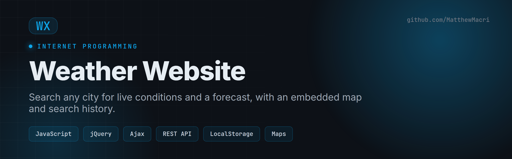
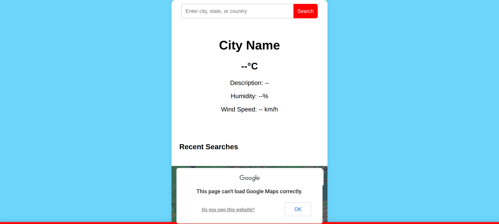

# Weather Website

> Search any city for live conditions and a forecast — with an embedded map, input validation, and a saved search history.


Built for **Internet Programming (420-311-VA)** at Vanier College.

---

## Overview

A client-side web app that fetches real-time weather for any location and renders it dynamically with JavaScript and the DOM API. It combines a REST weather API, an embedded map, a jQuery UI date picker, and browser Local Storage to remember recent searches.

## Preview



> The screenshot shows the empty state. Live temperature, humidity, wind, and the map populate once a weather API key and a Maps key are configured (see below).

## Features

- 🔎 **Location search** with user input validation
- 🌡️ **Current conditions** — temperature, description, humidity, wind speed
- 🗺️ **Embedded map** centered on the searched location (iframe / Maps embed)
- 📅 **Date picker** via a jQuery UI component
- 🕑 **Search history** persisted with the Local Storage API
- ⚡ **Ajax / Fetch** requests with JSON parsing and error handling
- 📱 **Responsive** layout for mobile and desktop

## Tech Stack

| Area | Tools |
|------|-------|
| Core | HTML5, CSS3, Vanilla JavaScript |
| UI component | jQuery + jQuery UI (date picker) |
| Data | REST weather API (Ajax/Fetch, JSON) |
| Map | Embedded Maps iframe |
| Storage | Browser Local Storage |

## Getting Started

```bash
git clone https://github.com/MatthewMacri/Internet-Programming-Project.git
cd Internet-Programming-Project/Deliverable-2

# serve locally (any static server works)
python3 -m http.server 8000   # then visit http://localhost:8000
```

### API keys

To see live data, add your own keys in the script configuration:

- A weather API key (e.g. OpenWeatherMap)
- A Google Maps embed/API key for the map panel

Without keys the interface still renders; data fields show placeholders.

## Project Structure

```
.
├── Deliverable-1/    # Project plan & wireframes
├── Deliverable-2/    # HTML/CSS/JS implementation  ← run this
├── Project Report/   # Documentation
└── PROJECT.md        # Original assignment brief
```

## Author

**Matthew Macri** — [LinkedIn](https://www.linkedin.com/in/m-macri/) · [GitHub](https://github.com/MatthewMacri)

## License

Released under the [MIT License](LICENSE).
